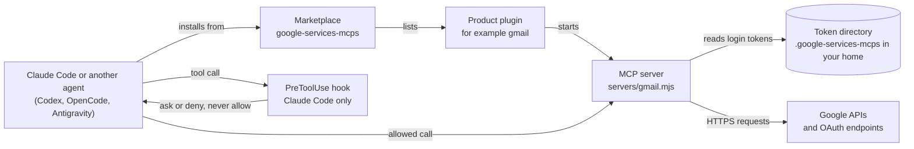

# Google Workspace, Google Cloud, Google Search Console, Google Ads and more as MCP servers for Claude Code, Codex, OpenCode and Antigravity


**google-services-mcps** is a Google Workspace MCP, Google Cloud MCP and Search Console MCP suite. It includes a Gmail MCP, a Google Drive MCP, a Google Calendar MCP and a Google Ads MCP, plus 19 more Google products. Each product is one **Model Context Protocol** server, packaged as a **Claude Code plugin** in one marketplace. An installer adds the same servers to a Codex MCP, an OpenCode MCP and an Antigravity MCP setup. Use it to let an AI agent read your Google data and, when you allow it, change that data.

> **Status: beta.** Built and tested offline: 489 passing tests (one more downloads from GitHub and runs only with `GSM_NETWORK_TESTS=1`), a smoke test over all 23 servers, and Claude plugin validation. Not yet tested against live Google accounts. The repository is public. Licensed under Apache-2.0.

## At a glance

- **One plugin per product.** 23 products and 3,334 tools in all. Install only the products you use.
- **Safe by default.** Reads never ask. Write tools stay off until you turn on **Allow write tools**. Changes ask first, and deletions and sends ask twice.
- **Your own credentials.** Sign in with your own OAuth client, API key or service account. The servers call Google directly, and tokens stay in a folder on your machine.

### Quick start

One line installs the suite and Gmail (`gmail`) for Claude Code. No clone and no build are needed. Pick the line for your shell:

Windows PowerShell:

```powershell
& ([scriptblock]::Create((irm "https://raw.githubusercontent.com/FiredMosquito831/google-services-mcps/main/scripts/install.ps1"))) install --agent claude --plugin gmail
```

Windows Command Prompt:

```bat
curl -fsSL -o "%TEMP%\install-gsm.cmd" https://raw.githubusercontent.com/FiredMosquito831/google-services-mcps/main/scripts/install.cmd && "%TEMP%\install-gsm.cmd" install --agent claude --plugin gmail
```

Linux, macOS and WSL:

```sh
curl -fsSL "https://raw.githubusercontent.com/FiredMosquito831/google-services-mcps/main/scripts/install.sh" | sh -s -- install --agent claude --plugin gmail
```

The line downloads the suite to `google-services-mcps` in your home folder and runs the installer from there. Add `--dry-run` at the end to see the agent changes without making them; the download and the folder are written either way.

Sign in from that folder (Windows: `%USERPROFILE%\google-services-mcps`; Linux and macOS: `~/google-services-mcps`):

```sh
node gsm.mjs setup-client path/to/client_secret.json && node gsm.mjs login workspace-user
```

Then restart Claude Code and run `/mcp` to check that `gmail` is connected. The `client_secret.json` comes from a Desktop OAuth client you create in the Google Cloud console. See [Sign in](#sign-in).

## Contents

- [What is this?](#what-is-this)
- [The 23 products](#the-23-products)
- [Install](#install)
- [Sign in](#sign-in)
- [How it stays safe](#how-it-stays-safe)
- [Choosing products](#choosing-products)
- [Using it](#using-it)
- [Limits and costs](#limits-and-costs)
- [Command reference](#command-reference)
- [Repository layout](#repository-layout)
- [Development](#development)
- [FAQ](#faq)
- [Status and roadmap](#status-and-roadmap)
- [Contributing](#contributing)
- [Security](#security)
- [Acknowledgements and trademarks](#acknowledgements-and-trademarks)

## What is this?

The suite has three layers.

| Layer | What it is | Example |
|---|---|---|
| Marketplace | The `google-services-mcps` catalogue (`.claude-plugin/marketplace.json`). It lists the 23 plugins. | `claude plugin marketplace add` |
| Plugin | One Google product, packaged for Claude Code. It holds the MCP server, a consent hook, a tool map and a skill. | `gmail@google-services-mcps` |
| MCP server | A local Node.js process. Claude Code starts it over stdio. It exposes the product's tools and calls Google's APIs. | `servers/gmail.mjs` |

### Why one plugin per product

- **You install only what you use.** Each plugin adds its tools to your session, so fewer plugins means less to load.
- **Each product has its own login group.** Products in one group share one login. A Search Console login does not reach Gmail.
- **You can switch one server off for a session.** Use `/mcp` to turn a server off, and on again later, without uninstalling it.
- **Tool names show the product.** Every tool name starts with `mcp__plugin_<product>_`, so a call always traces back to one product.

### How the pieces connect



The hook runs only in Claude Code. Codex, OpenCode and Antigravity have no approval hook in this suite. See [How it stays safe](#how-it-stays-safe).

## The 23 products

Each product id is also its plugin name. The table below is generated from `config/products.json` and each plugin's `tool-map.json` by `scripts/gen-readme.mjs`. Products with gateway APIs can also reach those APIs through `api_search`, `api_describe` and `api_call`. See [Using it](#using-it).

<!-- products:start -->

Generated by `scripts/gen-readme.mjs` from `config/products.json` and `plugins/<id>/tool-map.json`. Edit the generator, not this table.

| Product | What it manages | Login group | Tools | Gateway APIs | Install (Claude Code) |
|---|---|---|---:|---:|---|
| [`gcloud`](docs/products/gcloud.md) | Google Cloud console APIs: projects, service enablement, API keys, billing, monitoring, storage, BigQuery and IAM... | `cloud` | 374 | 277 | `node gsm.mjs install --agent claude --plugin gcloud` |
| [`gsc`](docs/products/gsc.md) | Search Console sites, sitemaps, search analytics, URL indexing and site verification. | `searchconsole` | 31 | 0 | `node gsm.mjs install --agent claude --plugin gsc` |
| [`gsearch`](docs/products/gsearch.md) | Public search and web-quality APIs (Custom Search, PageSpeed, CrUX, Safe Browsing, Web Risk, Fact Check)... | `apikey` | 51 | 2 | `node gsm.mjs install --agent claude --plugin gsearch` |
| [`gdrive`](docs/products/gdrive.md) | Google Drive files, labels and activity, plus Docs, Sheets, Slides, Forms and Books. | `workspace-user` | 185 | 2 | `node gsm.mjs install --agent claude --plugin gdrive` |
| [`gmail`](docs/products/gmail.md) | Gmail mailboxes, messages, labels and settings, plus Gmail Postmaster Tools. | `workspace-user` | 97 | 2 | `node gsm.mjs install --agent claude --plugin gmail` |
| [`gcalendar`](docs/products/gcalendar.md) | Google Calendar calendars, events and calendar settings. | `workspace-user` | 46 | 0 | `node gsm.mjs install --agent claude --plugin gcalendar` |
| [`gchat`](docs/products/gchat.md) | Google Chat spaces, messages and members, plus Workspace Events subscriptions. | `workspace-user` | 61 | 0 | `node gsm.mjs install --agent claude --plugin gchat` |
| [`gmeet`](docs/products/gmeet.md) | Google Meet spaces, conference records, participants and recordings. | `workspace-user` | 25 | 0 | `node gsm.mjs install --agent claude --plugin gmeet` |
| [`gcontacts`](docs/products/gcontacts.md) | Google Contacts and People, personal health metrics, Data Portability, and the OAuth2 userinfo endpoints. | `workspace-user` | 63 | 2 | `node gsm.mjs install --agent claude --plugin gcontacts` |
| [`gtasks`](docs/products/gtasks.md) | Google Tasks task lists and tasks, plus Google Keep notes. | `workspace-user` | 22 | 0 | `node gsm.mjs install --agent claude --plugin gtasks` |
| [`gclassroom`](docs/products/gclassroom.md) | Google Classroom courses, coursework, submissions, students and teachers. | `workspace-user` | 105 | 0 | `node gsm.mjs install --agent claude --plugin gclassroom` |
| [`gapps`](docs/products/gapps.md) | Apps Script projects and execution, plus the Workspace Marketplace SDK. | `workspace-user` | 19 | 0 | `node gsm.mjs install --agent claude --plugin gapps` |
| [`gadmin`](docs/products/gadmin.md) | Google Workspace administration: Cloud Identity, Chrome management and policy, Groups Settings, licensing, reports... | `workspace-admin` | 366 | 4 | `node gsm.mjs install --agent claude --plugin gadmin` |
| [`ganalytics`](docs/products/ganalytics.md) | Google Analytics admin and data APIs for GA4 properties, configuration and reports. | `business` | 70 | 1 | `node gsm.mjs install --agent claude --plugin ganalytics` |
| [`gtm`](docs/products/gtm.md) | Google Tag Manager accounts, containers, tags, triggers and variables. | `business` | 110 | 1 | `node gsm.mjs install --agent claude --plugin gtm` |
| [`gyoutube`](docs/products/gyoutube.md) | YouTube Data, YouTube Analytics and YouTube Reporting APIs, plus Blogger. | `business` | 125 | 0 | `node gsm.mjs install --agent claude --plugin gyoutube` |
| [`gbusiness`](docs/products/gbusiness.md) | Business Profile accounts, locations, verifications, lodging, place actions, notifications and performance. | `business` | 52 | 0 | `node gsm.mjs install --agent claude --plugin gbusiness` |
| [`gads`](docs/products/gads.md) | Google Ads API, plus advertising and publisher APIs: Search Ads 360, Display & Video 360, Campaign Manager... | `business` | 330 | 25 | `node gsm.mjs install --agent claude --plugin gads` |
| [`gmerchant`](docs/products/gmerchant.md) | Merchant Center: Merchant API, Comparison Shopping Service and Manufacturer Center. | `business` | 158 | 12 | `node gsm.mjs install --agent claude --plugin gmerchant` |
| [`gplay`](docs/products/gplay.md) | Google Play developer publishing and reporting, Play Games Services, Android Enterprise and Management... | `developer` | 353 | 7 | `node gsm.mjs install --agent claude --plugin gplay` |
| [`gfirebase`](docs/products/gfirebase.md) | Firebase management, App Check, App Distribution, Crashlytics, Hosting, Data Connect, Rules, Test Lab... | `developer` | 301 | 9 | `node gsm.mjs install --agent claude --plugin gfirebase` |
| [`gmaps`](docs/products/gmaps.md) | Maps Platform and location APIs: Places, Address Validation, Solar, Air Quality, Pollen... | `developer` | 36 | 0 | `node gsm.mjs install --agent claude --plugin gmaps` |
| [`gai`](docs/products/gai.md) | Generative and classic AI APIs: Discovery Engine, Vertex AI, Dialogflow, Vision, Speech, Translate... | `cloud` | 354 | 47 | `node gsm.mjs install --agent claude --plugin gai` |

**Totals:** 23 products, 3334 tools, 391 gateway APIs.

**Tools** counts every tool in the plugin, including the `api_*` gateway tools. Write and destructive tools are listed only when **Allow write tools** is on. **Gateway APIs** are reached through `api_search`, `api_describe` and `api_call`.
<!-- products:end -->

The login groups are `cloud`, `searchconsole`, `workspace-user`, `workspace-admin`, `business`, `developer` and `apikey`. Each group has its own setup in [Sign in](#sign-in).

## Install

Install with one command. Three ways, all with the same install command:

1. **One line, no clone.** The Quick start above. The line downloads the suite to `google-services-mcps` in your home folder and runs the installer there.
2. **npm.** `npx @firedmosquito831/google-services-mcps install --agent <agent> --plugin <product>`. Or install once with `npm install -g @firedmosquito831/google-services-mcps`, then run `gsm install --agent <agent> --plugin <product>`. In a terminal, `npx @firedmosquito831/google-services-mcps` with no arguments opens a menu, and `install` asks for anything you leave out. Every command and option is listed in [docs/INSTALL.md](docs/INSTALL.md#npm-and-npx-commands).3. **From a clone**, from the repository folder. No build is needed:

```
node gsm.mjs install --agent <agent> --plugin <product>
```

- `<agent>` is `claude` (Claude Code), `codex`, `opencode` or `agy` (Antigravity).
- `<product>` is a product id such as `gmail`, several ids separated by commas (`gmail,gcalendar`), or `all`.

The default scope is `global`, which installs for your user account. Add `--scope project --path <folder>` or `--scope local --path <folder>` to install for one folder. Antigravity supports `global` only.

| Agent | `global` (default) | `project` or `local` |
|---|---|---|
| Claude Code (`claude`) | `--scope user`: all your projects | `.claude/settings.json` or `.claude/settings.local.json` in the folder |
| Codex (`codex`) | `~/.codex/config.toml` | `.codex/config.toml` in the folder |
| OpenCode (`opencode`) | `~/.config/opencode/opencode.json` | `opencode.json` in the folder |
| Antigravity (`agy`) | `~/.gemini/config/mcp_config.json` | refused (exit code 2) |

For example, Gmail for Claude Code:

```
node gsm.mjs install --agent claude --plugin gmail
```

Run `--dry-run` first to see every change before anything is written. For Claude Code, the first install also adds the marketplace. Restart the agent after an install.

- The plugin options of Claude Code (**Allow write tools**, **Confirm before changes**, **Token directory**) are set in `/plugin`, or with `claude plugin configure`. See the tutorial.
- Project and local files contain absolute paths on your machine. Do not commit them for a team.

The full walkthrough, with the checks and the sign-in steps, is in [docs/TUTORIAL.md](docs/TUTORIAL.md). Every command and flag is in [docs/INSTALL.md](docs/INSTALL.md).

## Sign in

Each product belongs to one login group. You log in once per group, with the products of that group that you use.

| Group | Products | Setup |
|---|---|---|
| `cloud` | `gcloud`, `gai` | Desktop OAuth client, then `login cloud` |
| `searchconsole` | `gsc` | Desktop OAuth client, then `login searchconsole` |
| `workspace-user` | `gdrive`, `gmail`, `gcalendar`, `gchat`, `gmeet`, `gcontacts`, `gtasks`, `gclassroom`, `gapps` | Desktop OAuth client, then `login workspace-user` |
| `workspace-admin` | `gadmin` | Service account with domain-wide delegation, then `setup-admin` |
| `business` | `ganalytics`, `gtm`, `gyoutube`, `gbusiness`, `gads`, `gmerchant` | Desktop OAuth client, then `login business` |
| `developer` | `gplay`, `gfirebase`, `gmaps` | Desktop OAuth client, then `login developer` |
| `apikey` | `gsearch` | API key, then `setup-apikey`. No login. |

### Desktop OAuth client (most groups)

1. In the Google Cloud console, create a project for the suite. Enable the APIs of the products you use.
2. Configure the OAuth consent screen. Use **Internal** for a Workspace domain. An external app left in **Testing** loses its refresh token after 7 days.
3. Create an OAuth client ID of type **Desktop app**, then download its JSON file.
4. Save the file and log in. Start with a read-only profile and one group:

```sh
node gsm.mjs setup-client path/to/client_secret.json
node gsm.mjs login workspace-user --profile readonly --servers gmail,gcalendar
node gsm.mjs status
```

After a login, restart the server so the new scopes apply. Run `/mcp` in Claude Code and reconnect, or restart the agent.

| Profile | What it covers |
|---|---|
| `readonly` (default) | Read tools, with read-only scopes. |
| `readwrite` | Read, write and destructive tools, with the narrowest scopes that cover them. |
| `full` | Every tool, with the broadest listed scope. Use it rarely. |
| `--scopes <urls>` | Exactly the scopes you list. Nothing else is added. |

A login merges with the scopes already stored for its group, so one product's login keeps the others. Use `--replace` to drop the stored scopes. A merge can leave write scopes from an earlier `readwrite` login in place. To get a read-only token back, log in again with `--replace`.

### Workspace admin (gadmin)

`gadmin` uses a service account with domain-wide delegation, not a user login. You need a super admin and a Google Cloud service account JSON key.

```sh
node gsm.mjs scopes workspace-admin --profile readonly
node gsm.mjs setup-admin --subject admin@example.com --key-file path/to/key.json --profile readonly
```

The first command prints the scopes to allow in the Google Admin console, under **Domain-wide delegation**. The key file is read where it is and is never copied. Organisations created on or after 2024-05-03 block service account key creation by default. Ask your administrator for an exception, or use another setup.

### Google Ads (gads)

Access to the Google Ads API comes from the Google Cloud project of your OAuth client. Google sunset developer tokens on 2026-09-09. The developer token is optional in this suite: the suite sends it only when one is set. If you reach client accounts through a manager (MCC) account, set the plugin option **Manager (login) customer ID**. Test access works only on test accounts. See [docs/SETUP.md](docs/SETUP.md).

### API key (gsearch)

`gsearch` takes a key, not a login.

```sh
node gsm.mjs setup-apikey
```

The command reads the key from the environment variable `GSM_API_KEY_INPUT` or from stdin. It never takes the key as an argument and never prints it. The key is saved as `apikey.json` in the token directory. The Custom Search JSON API is reported closed to new customers and discontinued on 2027-01-01. Check that in the Google Cloud console before you rely on it.

### Token directory and Google rules

- Tokens are stored in `~/.google-services-mcps`, or in the folder set by the plugin option **Token directory** or `GSM_TOKEN_DIR`. Files are written with mode 0600 where the platform supports it. Mode 0600 is not enforced on Windows, so protect the folder with your account's permissions.
- `node gsm.mjs logout <group>` removes one group's token. It does not revoke access at Google. Revoke it at [myaccount.google.com/permissions](https://myaccount.google.com/permissions).
- Restricted scopes (most Gmail and Drive scopes) need Google's verification for public apps. Internal Workspace apps are not affected.

Full setup for each group is in [docs/SETUP.md](docs/SETUP.md).

## How it stays safe

The controls apply in order, and one failing layer does not let a change through.

1. **Token scopes.** A login asks only for the scopes of its profile. Google rejects any call outside them, whatever the plugin shows.
2. **Tool registration.** A write or destructive tool is listed only when **Allow write tools** is on. It is off by default.
3. **Approval gate.** Every change and deletion passes one gate before it runs. In Claude Code, a `PreToolUse` hook asks first. The hook never allows a call, so your own permission rules still apply. Deletions, sends and disables ask twice: once in the hook, and once with the exact action in an **Approve this action?** form.
4. **Confirmation setting.** You choose how often to ask. The options are in the table below.
5. **Policy file.** `policy.json` in the token directory holds `allow`, `ask` and `deny` rules. A matching `deny` always wins, then a matching `ask`, then a matching `allow`.
6. **Audit log.** Each gated action writes one JSON line to `audit.log`. The line holds the time, tool, method, decision and outcome. It holds a 16-character hash of the arguments, never the values. Reads are not logged.
7. **Secrets.** Tokens, the client file and the API key stay in the token directory. Nothing secret goes into plugin files or agent config files.
8. **Retries.** Throttled requests (HTTP 429 and 503, and some read 403s) are retried, up to three attempts in all. Then the error reaches the agent.

### Confirmation options

| Mode | Reads | Changes | Deletions and sends |
|---|---|---|---|
| `every-change` (default) | No prompt | Prompt | Prompt, then the second approval |
| `destructive-only` | No prompt | No prompt | Prompt, then the second approval |
| `off` | No prompt | No prompt | No prompt. Deny rules still apply. |

Set it with the plugin option **Confirm before changes**. Use `off` only on an account you fully control.

### Known limits

- The hook and the approval form have not yet been tested in a live Claude Code session.
- Codex, OpenCode and Antigravity have no approval hook here. A client that cannot ask for approval is refused every change, so nothing runs without a confirmation.
- Some methods named like reads (for example `evaluateDataset` in `gai`) may start work. Add an `ask` rule in `policy.json` for those method ids.
- Claude Code's **Yes, and don't ask again** may or may not skip the suite's prompt for a change. Do not use it for write or delete tools until that is tested.
- Mail, documents and files can contain instructions aimed at the agent. Read the approval text before you accept.

The full model and its limits are in [docs/SECURITY.md](docs/SECURITY.md).

## Choosing products

Install a product only when you have a use for it. Start with the `readonly` profile, add one product at a time, and turn on writes later. These example bundles show common combinations.

| Use | Install | Login group | Start with |
|---|---|---|---|
| Personal assistant | `gmail`, `gcalendar`, `gcontacts` | `workspace-user`, one login | Read mail and events, then try one draft or one event. |
| Workspace admin | `gadmin`, `gdrive` | `workspace-admin` and `workspace-user` | `readonly` for both. Keep **Allow write tools** off. |
| SEO and search | `gsc`, `gsearch` | `searchconsole` and `apikey` | `gsc` read-only. `gsearch` needs only an API key. |
| Marketing and analytics | `ganalytics`, `gtm`, `gyoutube` | `business`, one login | Read reports first. Check the YouTube quota before a large run. |

`gadmin` and `gads` can change real users and spend real money, so they carry the highest risk. [docs/CHOOSING.md](docs/CHOOSING.md) has the decision table by goal, with cost and risk for each product.

## Using it

### Tool names

Claude Code names each plugin tool like this:

```
mcp__plugin_gmail_gmail__gmail_users_messages_list
```

- The first `gmail` is the plugin. The second is the server. For every product, both are the product id.
- `gmail_users_messages_list` is the method `gmail.users.messages.list`, with the dots turned into underscores.
- Tool names are at most 64 characters.

### Gateway tools

Every product has `api_methods`, which lists its methods. Products with gateway APIs also have three gateway tools. These reach the methods that do not have a tool of their own:

- `api_search` finds methods by text. It is a read.
- `api_describe` shows a method's verb, path, safety class, scopes and parameters. It is a read.
- `api_call` calls any method of the product. It follows the same safety rules as any other tool.

The products with gateway APIs are listed in the [products table](#the-23-products).

### An example conversation

> Show the subjects of my five most recent Gmail messages.

Claude calls `mcp__plugin_gmail_gmail__gmail_users_messages_list`, then the get tool for each message. Reads never ask.

> Delete all emails from newsletter@example.com that are older than a year.

Claude first searches, which is a read. It then proposes `mcp__plugin_gmail_gmail__gmail_users_messages_batch_delete`, which is destructive. Claude Code shows its prompt, labelled `[plugin:gmail]`. You approve it, then accept the **Approve this action?** form. Declining either step deletes nothing.

For the daily workflow, the policy file and the common errors, read [docs/USING.md](docs/USING.md). Each product's tools and use cases are in [docs/products/](docs/products/). The full tool list per product is in [docs/CAPABILITIES.md](docs/CAPABILITIES.md).

## Limits and costs

The suite adds no charge of its own. Each call goes from your machine to Google, under your own OAuth client, API key or service account, so Google's quotas, billing and approval rules apply to every call. Claude's own usage also grows with each installed product, because every product adds tool definitions to the session.

> **UNVERIFIED caveat.** The figures below are summaries of the limits files. A tag marked **UNVERIFIED** there means the value could not be confirmed on an official page. Quotas change, so check the **Quotas** page in your Google Cloud project before you rely on any number.

| Family | Products | Free to use | Paid | Approval needed |
|---|---|---|---|---|
| Workspace user data | `gdrive`, `gmail`, `gcalendar`, `gchat`, `gmeet`, `gcontacts`, `gtasks`, `gclassroom`, `gapps` | Included with Google Workspace, with per-project and per-user quotas | Planned overage charges for some APIs, from later in 2026, with no amount given (UNVERIFIED) | Sensitive and restricted scopes need Google review for public apps |
| Workspace admin | `gadmin` | Admin SDK APIs are included with Workspace | Fee not confirmed (UNVERIFIED) | A service account with domain-wide delegation. Key creation is blocked by default for new organisations. |
| Google Cloud and AI | `gcloud`, `gai` | Free Tier, which needs a billing account. Some Gemini Flash models have a free tier. | Pay-as-you-go prices (UNVERIFIED). Gemini Pro models are paid. | Quota increases in the console. Some need payment in advance. |
| Search | `gsc`, `gsearch` | Indexing API is free. Some public APIs have free allowances (some UNVERIFIED). | Search Console API fee (UNVERIFIED). Custom Search has a paid tier. | An API key. Custom Search is reported closed to new customers and discontinued on 2027-01-01. |
| Ads, business and video | `gads`, `gbusiness`, `ganalytics`, `gtm`, `gyoutube`, `gmerchant` | Google Ads access levels are stated to have no cost. Other costs are UNVERIFIED. | A non-compliance fee can apply to a Google Ads tool that fails Required Minimum Functionality (UNVERIFIED which level) | Google Ads access comes from the Cloud project. Basic needs brand verification and Standard needs a manual audit. Business Profile needs Basic API Access. |
| Developer and mobile | `gplay`, `gfirebase`, `gmaps` | Firebase Spark is a no-cost plan. Maps gives free calls per SKU each month. | Play Console registration, once. Firebase Blaze and Maps billing are usage-based. | Play needs a service account invited in Play Console. Maps needs billing on each project. |

Read the per-product figures in [docs/LIMITS-AND-COSTS.md](docs/LIMITS-AND-COSTS.md). The detailed limits files are in [docs/limits/](docs/limits/).

## Command reference

The `node gsm.mjs` installer and login tool is `node gsm.mjs`, run from the root of a clone. No build is needed. Each plugin folder also has its own `bin/gsm.mjs`, which knows only its own product.

| Command | What it does |
|---|---|
| `install` | Install product plugins for an agent: `claude`, `codex`, `opencode`, `agy` or `all`. |
| `uninstall` | Remove the product plugins again. Only the `node gsm.mjs` entries are removed. |
| `login` | Log in one OAuth group. |
| `scopes` | Show each profile's scopes, the products of a group and their tool counts. |
| `setup-client` | Save the OAuth Desktop client file. |
| `setup-apikey` | Save the API key for the `apikey` group. |
| `setup-admin` | Set up the `workspace-admin` group with a service account and a super admin. |
| `status` | Show logins, the API key and the security posture of each token. |
| `logout` | Remove one group's stored token. |
| `products` | List the products, with group, tool count and gateway APIs. |
| `apis` | List the APIs of a product, or of the whole catalog. |
| `methods` | List the methods of one catalog API, with verb, path and kind. |
| `doctor` | Check plugin folders, hooks, tool names, the token directory and credentials. |
| `version` | Show the suite version and the Node version. |

<details>
<summary>Full output of <code>gsm --help</code></summary>

```
gsm: install the Google services MCP suite into an agent, and manage it

Examples:
  node gsm.mjs install --agent codex --plugin gmail                        Gmail for Codex, for this user (global is the default)
  node gsm.mjs install --agent claude --plugin gcalendar --scope project   Google Calendar for Claude Code, in this project only
  node gsm.mjs list                                                        Show every install gsm made, and where
  node gsm.mjs uninstall --agent codex --plugin gmail --dry-run            Preview the removal of the Gmail entry

Commands:
  install       Install product plugins for an agent: claude, codex, opencode, agy, or all
  uninstall     Remove product plugins again, or every install with --all. Only gsm's own entries are removed
  list          Show every install gsm made: agent, scope, folder, products, and whether it is still in place
  login         Log in one OAuth group. "node gsm.mjs login apikey" only explains the API key step
  scopes        Show each profile's scopes, the products of a group and their tool counts
  setup-client  Save the OAuth Desktop client file (client_secret.json)
  setup-apikey  Save the API key for the apikey group (reads GSM_API_KEY_INPUT or stdin)
  setup-admin   Set up workspace-admin: service account and super admin subject
  status        Show logins, the API key and the security posture of each token
  logout        Remove one group's stored token (apikey: shows where the key file is)
  products      List the products: id, title, group, tool count, gateway APIs and whether the plugin folder exists
  apis          List the APIs of a product (generated and gateway), or of the whole catalog, with method counts
  methods       List the methods of one catalog API: id, HTTP verb, path and kind (read, write or destructive)
  doctor        Check the plugin folders, hooks, tool names, token directory and credentials: PASS or FAIL per check
  version       Show the suite version and the Node version
  --help        Show this help

Usage:
  node gsm.mjs install   --agent <claude|codex|opencode|agy|all> --plugin <id[,id...]|all> [--scope global|project|local]
                         [--path <dir>] [--allow-writes] [--confirmation <every-change|destructive-only|off>] [--dry-run]
  node gsm.mjs uninstall --agent <claude|codex|opencode|agy|all> --plugin <id[,id...]|all> [--scope global|project|local]
                         [--path <dir>] [--dry-run]
  node gsm.mjs uninstall --all [--dry-run] [--yes]
  node gsm.mjs list [--json] [--home <dir>]
  node gsm.mjs login <group> [--profile readonly|readwrite|full] [--scopes <url,url>] [--servers <a,b>] [--client-secret <file>] [--no-browser] [--replace]
  node gsm.mjs scopes <group> [--profile readonly|readwrite|full] [--servers <a,b>] [--json]
  node gsm.mjs setup-client <path-to-client_secret.json> [--force]
  node gsm.mjs setup-apikey [--force]
  node gsm.mjs setup-admin --subject <admin email> --key-file <service account JSON> [--profile readonly|readwrite|full] [--servers <a,b>] [--replace]
  node gsm.mjs status
  node gsm.mjs logout <group>
  node gsm.mjs products [--json]
  node gsm.mjs apis [<product>] [--search <text>] [--json] [--limit <n>]
  node gsm.mjs methods <api> [<version>] [--search <text>] [--json] [--limit <n>]
  node gsm.mjs doctor [--plugin <id>] [--token-dir <dir>]
  node gsm.mjs version
  node gsm.mjs --help

Install and uninstall:
  --agent       claude (the claude CLI), codex (config.toml), opencode (opencode.json), agy (global only), or all.
  --scope       global (default): your user-wide config. project: the folder of --path, or the current folder.
                local: only that folder, not shared. "folder" is accepted as an alias of local.
                Codex and OpenCode have no separate local file, so project and local write the same file.
  --path        The folder for project and local scope. It must exist.
  --plugin      Product ids such as gcloud, gsc, gmail or gai, or all. An unknown id is refused, and the error lists them.
  --dry-run     Prints every planned change and command, and writes nothing.
  --allow-writes, --confirmation   Set GSM_ALLOW_WRITES and GSM_CONFIRMATION for codex, opencode and agy.
                For claude they are plugin options: the install prints the command that sets them.
  --marketplace claude only: owner/repo, a URL or a path. Default: this checkout, else FiredMosquito831/google-services-mcps.
  --all         uninstall only: removes every install in the list. It prints the list, then asks; --yes skips the question.
  --keep-data   uninstall with claude: keeps the plugin data directory.
  --home        A home folder other than yours, for tests. Not for claude.
Runtime:  install copies each product's servers and hook to ~/.google-services-mcps/runtime/<product>/, and the codex,
          opencode and agy configs point there. uninstall removes a copy when no other install uses it.
          Logins (the token files) are never touched by install or uninstall.

Profiles: readonly (default) covers the read tools with read-only scopes. readwrite adds write and destructive tools
          with the narrowest scopes that cover them. full covers every tool. --scopes gives an exact list instead.
          The scopes a token holds decide which tools run: a tool whose scopes it lacks is not registered.
Groups:   OAuth login: cloud, workspace-user, searchconsole, business, developer. apikey: setup-apikey, no login.
          workspace-admin: setup-admin (service account with domain-wide delegation).
Flags:    --no-browser (login) prints the login URL only, and does not open the browser.
          --replace (login, setup-admin): by default a login merges the requested scopes with the stored ones; --replace drops the stored ones.
          --json (scopes, products, apis, methods, list) prints JSON.
API key:  setup-apikey reads GSM_API_KEY_INPUT or stdin. The key is never a command-line argument and is never printed.
Backups:  an existing config file is copied to <file>.gsm-backup-<YYYYMMDD-HHMMSS> before it changes.
Doctor:   --plugin checks one product. Without it, every product of this checkout (or this plugin folder) is checked.
          --token-dir checks another token directory. Exit 1 when any check FAILs. It creates nothing and prints no secret.

```

</details>

## Repository layout

```
.claude-plugin/   the marketplace manifest: the google-services-mcps marketplace, 23 plugins
.github/          issue templates and the pull request template
config/           products.json (source of truth), servers.json, tool-kinds.json, catalog-plugins.json
data/             Discovery catalog and scopes data (catalog.json, scopes.json, catalog-errors.json)
docs/             guides, the capability inventory, limits, and one page per product
plugins/          one generated plugin per product (23 folders), each with its server, hook and skill
scripts/          generators, the bundler, the smoke test and this README's product table
src/              TypeScript source: core engine, curated servers, the gsm CLI and the approval hook
tests/            Node test files, run with node --test
package.json      scripts and dependencies
tsconfig.json     TypeScript settings
```

Generated and not committed: `dist/` (the compiled CLI), `build/` (generated server entries), and `node_modules/`. The `.gitignore` also keeps out tokens, client files and keys.

## Development

Requires Node.js 20 or newer.

```sh
npm install                          # dependencies
npm run typecheck                    # TypeScript check, no output
npm run build                        # compile, then bundle the 23 plugins into plugins/<id>/
npm test                             # compile, then the unit and build-output tests
node scripts/smoke.mjs               # start every plugin server over stdio (after npm run build)
npm run surfaces                     # regenerate docs/SURFACES.md
node scripts/gen-capabilities.mjs    # regenerate docs/CAPABILITIES.md and docs/capabilities/
node scripts/gen-readme.mjs          # regenerate the product table in this README
node scripts/gen-servers.mjs         # regenerate config/servers.json from config/products.json
node scripts/snapshot-discovery.mjs  # refresh the Discovery documents (needs network)
```

There is no npm script named `capabilities`. Run `node scripts/gen-capabilities.mjs` instead. To add a product, change `config/products.json`, then run the steps above. Validate a plugin with `claude plugin validate ./plugins/<id>`.

## FAQ

**Does it cost money?**
The suite is free. Google's quotas, billing and approval rules apply to each call you make. Claude's own usage grows with each installed product, because every product adds tool definitions. See [Limits and costs](#limits-and-costs).

**Which Google accounts do I need?**
A Google Workspace account is the main target. Each login group needs a Desktop OAuth client in a Google Cloud project. `gadmin` needs a super admin and a service account with domain-wide delegation. `gsearch` needs an API key. Consumer Google accounts are UNVERIFIED for most products.

**Is my data sent anywhere except Google?**
As far as the source shows, the servers call only Google's API and OAuth endpoints, and the code has no separate telemetry path. Tokens stay in the token directory on your machine. Note that anything a tool returns, such as mail text, becomes part of the agent's conversation, so it goes to that agent's model provider as usual.

**Can I use it with Codex?**
Yes. Run `node gsm.mjs install --agent codex --plugin <id>`. Codex has no approval hook in this suite, and a client that cannot ask for approval is refused every change. How Codex handles approvals is UNVERIFIED in a live session.

**Why do I see approval prompts?**
Changes and deletions ask by default (`every-change`). Deletions and sends also ask a second time. To ask less, set **Confirm before changes** to `destructive-only` or `off`. Deny rules in `policy.json` still apply.

**Why is a tool missing?**
Usually one of these: **Allow write tools** is off, so write and destructive tools are hidden. The login uses the `readonly` profile, so the token lacks the write scopes and the tool is not registered. The server is switched off in `/mcp`, or the plugin is disabled. If the group is not logged in, the tool is listed but each call fails with a login message. After a login, restart the server. `node gsm.mjs doctor --plugin <id>` checks the install.

**Why are there so many tools?**
Google's APIs are large. Each plugin has a tool for many of the methods of its APIs, and generated tools are capped at 350 per plugin. Gateway tools reach the methods that have no tool of their own. Install only the products you need. Claude Code's tool search loads definitions when they are needed.

**Is this an official Google product?**
No. It is not affiliated with or endorsed by Google. See [Acknowledgements and trademarks](#acknowledgements-and-trademarks).

**Can I use the code?**
Yes, under the Apache License, Version 2.0 (`Apache-2.0`). Copies you pass on must include the LICENSE and NOTICE files, and changed files must say that they were changed. See [License](#license).

**How do I remove everything?**
1. Preview the removal of every install: `node gsm.mjs uninstall --all --dry-run`. It prints the list and removes nothing.
2. Remove every install: `node gsm.mjs uninstall --all --yes`.
3. Delete the token folder `~/.google-services-mcps` by hand. It holds your OAuth client, logins, API key and admin setup. No gsm command deletes it. Keep `audit.log` if you need the record.
4. Remove the marketplace (Claude Code): `claude plugin marketplace remove google-services-mcps`.
5. Revoke the suite's access at [myaccount.google.com/permissions](https://myaccount.google.com/permissions), and delete the OAuth client in the Google Cloud console if you no longer need it.

The full steps are in [docs/TUTORIAL.md](docs/TUTORIAL.md), section 12.

## Status and roadmap

**Built and tested offline.**

- 23 plugins are generated and bundled, one per product.
- 408 unit and build tests pass.
- A smoke test starts all 23 servers over stdio, with an empty token directory, so nothing reaches Google.
- Claude plugin validation passes for the marketplace and the gmail plugin, which are the two checked so far.

**Not yet tested against live Google accounts.** Nothing has been run against a real account, including the approval hook and form in Claude Code, and the approval behaviour of Codex, OpenCode and Antigravity.

**Next, live tests.** Test one product at a time, starting with a read:

1. `gsc` (Search Console). Read-only profile, then list sites and one search analytics query.
2. `gmail`. Read-only profile, then read a few messages. Then create one draft on a test account.
3. `gcalendar`. Read-only profile, then create one event on a test account, with the approval prompt.

Then the other products, one at a time. The known limits are listed in [docs/SECURITY.md](docs/SECURITY.md#known-limits) and [docs/LIMITS-AND-COSTS.md](docs/LIMITS-AND-COSTS.md#9-known-conflicts-and-open-items).

## Contributing

- **File an issue** with the bug report or feature request template. Blank issues are disabled. Include the product id, the agent, the command or tool name and the error text. Remove tokens, client secrets, API keys, account data and private mail or file content before you post.
- **Before a pull request**, run:

  ```sh
  npm run typecheck
  npm test
  npm run build
  node scripts/smoke.mjs
  ```

- **Regenerate the docs** when you change products or tools: `npm run surfaces`, `node scripts/gen-capabilities.mjs` and `node scripts/gen-readme.mjs`.
- The pull request template lists these checks. Fill it in.

## Security

This repository is public, so do not put credentials or account data in an issue or a pull request. Private vulnerability reporting is not enabled yet. To report a security problem, contact the repository owner, [@FiredMosquito831](https://github.com/FiredMosquito831), through GitHub. Describe the problem without secrets, and without exploit details in a public place. The safety model and its limits are in [docs/SECURITY.md](docs/SECURITY.md).

## Acknowledgements and trademarks

**Acknowledgements.** This project studied community MCP projects for design ideas only, including [googleapis/gcloud-mcp](https://github.com/googleapis/gcloud-mcp), [taylorwilsdon/google_workspace_mcp](https://github.com/taylorwilsdon/google_workspace_mcp) and [mikusnuz/gsc-mcp](https://github.com/mikusnuz/gsc-mcp), and others. It copied no code from them. The suite is built from Google's published Discovery documents and the [Model Context Protocol specification](https://modelcontextprotocol.io/specification).

**Trademarks.** Google and the Google product names are trademarks of Google LLC. This project is not affiliated with or endorsed by Google.

### License

google-services-mcps is licensed under the **Apache License, Version 2.0** (SPDX identifier: `Apache-2.0`).

- Full license text: [LICENSE](LICENSE)
- Attribution notice that must travel with copies: [NOTICE](NOTICE)
- Why this license, and what it does and does not require: [docs/LICENSE-AND-ATTRIBUTION.md](docs/LICENSE-AND-ATTRIBUTION.md)
- Contributions are under the same license: [CONTRIBUTING.md](CONTRIBUTING.md)

**Attribution sentence to copy:**

> Based on google-services-mcps by FiredMosquito831 (https://github.com/FiredMosquito831/google-services-mcps, profile https://github.com/FiredMosquito831).

**How to credit this project**

Short, for a post:

```text
Based on google-services-mcps by FiredMosquito831 (https://github.com/FiredMosquito831/google-services-mcps, profile https://github.com/FiredMosquito831). Licensed under Apache-2.0.
```

Full, for documentation:

```text
This project is based on google-services-mcps by FiredMosquito831.
Repository: https://github.com/FiredMosquito831/google-services-mcps
Profile:    https://github.com/FiredMosquito831
License:    Apache License, Version 2.0 (Apache-2.0). See NOTICE and LICENSE.
```

Apache-2.0 requires the LICENSE and NOTICE files to travel with any copy you distribute or package, and changed files to say they were changed. Private use needs no credit. No open-source license can make people mention the project in every post, so the post text above is a request, not a legal duty.
