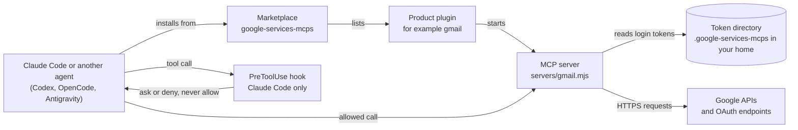

# Google Workspace, Google Cloud, Google Search Console, Google Ads and more as MCP servers for Claude Code, Codex, OpenCode and Antigravity


**google-services-mcps** is a Google Workspace MCP, Google Cloud MCP and Search Console MCP suite. It includes a Gmail MCP, a Google Drive MCP, a Google Calendar MCP and a Google Ads MCP, plus 19 more Google products. Each product is one **Model Context Protocol** server, packaged as a **Claude Code plugin** in one marketplace. An installer adds the same servers to a Codex MCP, an OpenCode MCP and an Antigravity MCP setup. Use it to let an AI agent read your Google data and, when you allow it, change that data.

> **Status: beta.** Built and tested offline: 646 passing tests (three are skipped: one downloads from GitHub and runs only with `GSM_NETWORK_TESTS=1`, and one checks the Windows folder access list only off Windows), a smoke test over all 23 servers, and Claude plugin validation. Not yet tested against live Google accounts. The repository is public. Licensed under Apache-2.0.

## At a glance

- **One plugin per product.** 23 products and 3,334 tools in all. Install only the products you use.
- **Safe by default.** Reads never ask. Write tools stay off until you turn on **Allow write tools**. Changes ask first, and destructive actions (deleting, sending, sharing, publishing and the others in [SECURITY.md](docs/SECURITY.md#the-destructive-rule)) ask twice.
- **Your own credentials.** Sign in with your own OAuth client, API key or service account. The servers call Google directly, and tokens stay in a folder on your machine.

### Quick start

One command installs the suite and Gmail (`gmail`) for Claude Code. No clone, no build and no global install are needed:

```sh
npx google-services-mcps install --agent claude --plugin gmail
```

`npx` downloads the package the first time and runs its installer. The command adds the `google-services-mcps` marketplace to Claude Code and installs the `gmail` plugin for your user account (the default, `--scope global`). It first checks what Claude Code needs, and it writes nothing until that is in place.

Prefer questions to flags? In a terminal, run the command with no arguments to open a guided menu. Each answer shows the exact command it will run:

```sh
npx google-services-mcps
```

Then sign in. Once per Google group, create a Desktop OAuth client in the Google Cloud console, give its JSON file to gsm, and log in (Gmail uses the `workspace-user` group):

```sh
npx google-services-mcps setup-client path/to/client_secret.json
npx google-services-mcps login workspace-user
```

Restart Claude Code and run `/mcp` to check that `gmail` is connected. The menu's **Sign in** item does the same steps. See [Sign in](#sign-in). The menu and `--install-missing` need version 0.1.3 or later of the npm package. Other ways to run the installer, and the older form from a clone, are in [Install](#install).

## Contents

- [What is this?](#what-is-this)
- [The 23 products](#the-23-products)
- [Install](#install)
- [Sign in](#sign-in)
- [How it stays safe](#how-it-stays-safe)
- [Choosing products](#choosing-products)
- [Using it](#using-it)
- [Limits and costs](#limits-and-costs)
- [Command reference](#command-reference)
- [Repository layout](#repository-layout)
- [Development](#development)
- [FAQ](#faq)
- [Status and roadmap](#status-and-roadmap)
- [Contributing](#contributing)
- [Security](#security)
- [Acknowledgements and trademarks](#acknowledgements-and-trademarks)

## What is this?

The suite has three layers.

| Layer | What it is | Example |
|---|---|---|
| Marketplace | The `google-services-mcps` catalogue (`.claude-plugin/marketplace.json`). It lists the 23 plugins. | `claude plugin marketplace add` |
| Plugin | One Google product, packaged for Claude Code. It holds the MCP server, a consent hook, a tool map and a skill. | `gmail@google-services-mcps` |
| MCP server | A local Node.js process. Claude Code starts it over stdio. It exposes the product's tools and calls Google's APIs. | `servers/gmail.mjs` |

### Why one plugin per product

- **You install only what you use.** Each plugin adds its tools to your session, so fewer plugins means less to load.
- **Each product has its own login group.** Products in one group share one login. A Search Console login does not reach Gmail.
- **You can switch one server off for a session.** Use `/mcp` to turn a server off, and on again later, without uninstalling it.
- **Tool names show the product.** Every tool name starts with `mcp__plugin_<product>_`, so a call always traces back to one product.

### How the pieces connect



The hook runs only in Claude Code. Codex, OpenCode and Antigravity have no approval hook in this suite. See [How it stays safe](#how-it-stays-safe).

## The 23 products

Each product id is also its plugin name. The table below is generated from `config/products.json` and each plugin's `tool-map.json` by `scripts/gen-readme.mjs`. Products with gateway APIs can also reach those APIs through `api_search`, `api_describe` and `api_call`. See [Using it](#using-it).

<!-- products:start -->

Generated by `scripts/gen-readme.mjs` from `config/products.json` and `plugins/<id>/tool-map.json`. Edit the generator, not this table.

| Product | What it manages | Login group | Tools | Gateway APIs | Install (Claude Code) |
|---|---|---|---:|---:|---|
| [`gcloud`](docs/products/gcloud.md) | Google Cloud console APIs: projects, service enablement, API keys, billing, monitoring, storage, BigQuery and IAM... | `cloud` | 395 | 280 | `npx google-services-mcps install --agent claude --plugin gcloud` |
| [`gsc`](docs/products/gsc.md) | Search Console sites, sitemaps, search analytics, URL indexing and site verification. | `searchconsole` | 39 | 0 | `npx google-services-mcps install --agent claude --plugin gsc` |
| [`gsearch`](docs/products/gsearch.md) | Public search and web-quality APIs (Custom Search, PageSpeed, CrUX, Safe Browsing, Web Risk, Fact Check)... | `apikey` | 60 | 2 | `npx google-services-mcps install --agent claude --plugin gsearch` |
| [`gdrive`](docs/products/gdrive.md) | Google Drive files, labels and activity, plus Docs, Sheets, Slides, Forms and Books. | `workspace-user` | 200 | 2 | `npx google-services-mcps install --agent claude --plugin gdrive` |
| [`gmail`](docs/products/gmail.md) | Gmail mailboxes, messages, labels and settings, plus Gmail Postmaster Tools. | `workspace-user` | 115 | 2 | `npx google-services-mcps install --agent claude --plugin gmail` |
| [`gcalendar`](docs/products/gcalendar.md) | Google Calendar calendars, events and calendar settings. | `workspace-user` | 57 | 0 | `npx google-services-mcps install --agent claude --plugin gcalendar` |
| [`gchat`](docs/products/gchat.md) | Google Chat spaces, messages and members, plus Workspace Events subscriptions. | `workspace-user` | 78 | 0 | `npx google-services-mcps install --agent claude --plugin gchat` |
| [`gmeet`](docs/products/gmeet.md) | Google Meet spaces, conference records, participants and recordings. | `workspace-user` | 34 | 0 | `npx google-services-mcps install --agent claude --plugin gmeet` |
| [`gcontacts`](docs/products/gcontacts.md) | Google Contacts and People, personal health metrics, Data Portability, and the OAuth2 userinfo endpoints. | `workspace-user` | 75 | 2 | `npx google-services-mcps install --agent claude --plugin gcontacts` |
| [`gtasks`](docs/products/gtasks.md) | Google Tasks task lists and tasks, plus Google Keep notes. | `workspace-user` | 31 | 0 | `npx google-services-mcps install --agent claude --plugin gtasks` |
| [`gclassroom`](docs/products/gclassroom.md) | Google Classroom courses, coursework, submissions, students and teachers. | `workspace-user` | 129 | 0 | `npx google-services-mcps install --agent claude --plugin gclassroom` |
| [`gapps`](docs/products/gapps.md) | Apps Script projects and execution, plus the Workspace Marketplace SDK. | `workspace-user` | 28 | 0 | `npx google-services-mcps install --agent claude --plugin gapps` |
| [`gadmin`](docs/products/gadmin.md) | Google Workspace administration: Cloud Identity, Chrome management and policy, Groups Settings, licensing, reports... | `workspace-admin` | 375 | 4 | `npx google-services-mcps install --agent claude --plugin gadmin` |
| [`ganalytics`](docs/products/ganalytics.md) | Google Analytics admin and data APIs for GA4 properties, configuration and reports. | `business` | 84 | 1 | `npx google-services-mcps install --agent claude --plugin ganalytics` |
| [`gtm`](docs/products/gtm.md) | Google Tag Manager accounts, containers, tags, triggers and variables. | `business` | 119 | 1 | `npx google-services-mcps install --agent claude --plugin gtm` |
| [`gyoutube`](docs/products/gyoutube.md) | YouTube Data, YouTube Analytics and YouTube Reporting APIs, plus Blogger. | `business` | 134 | 0 | `npx google-services-mcps install --agent claude --plugin gyoutube` |
| [`gbusiness`](docs/products/gbusiness.md) | Business Profile accounts, locations, verifications, lodging, place actions, notifications and performance. | `business` | 61 | 0 | `npx google-services-mcps install --agent claude --plugin gbusiness` |
| [`gads`](docs/products/gads.md) | Google Ads API, plus advertising and publisher APIs: Search Ads 360, Display & Video 360, Campaign Manager... | `business` | 340 | 26 | `npx google-services-mcps install --agent claude --plugin gads` |
| [`gmerchant`](docs/products/gmerchant.md) | Merchant Center: Merchant API and Comparison Shopping Service, through a service account key. | `service-account` | 167 | 12 | `npx google-services-mcps install --agent claude --plugin gmerchant` |
| [`gplay`](docs/products/gplay.md) | Google Play developer publishing and reporting, Play Games Services, Android Enterprise and Management... | `service-account` | 371 | 7 | `npx google-services-mcps install --agent claude --plugin gplay` |
| [`gfirebase`](docs/products/gfirebase.md) | Firebase management, App Check, App Distribution, Crashlytics, Hosting, Data Connect, Rules, Test Lab... | `developer` | 316 | 10 | `npx google-services-mcps install --agent claude --plugin gfirebase` |
| [`gmaps`](docs/products/gmaps.md) | Maps Platform and location APIs: Places, Address Validation, Solar, Air Quality, Pollen... | `apikey` | 47 | 0 | `npx google-services-mcps install --agent claude --plugin gmaps` |
| [`gai`](docs/products/gai.md) | Generative and classic AI APIs: Discovery Engine, Vertex AI, Dialogflow, Vision, Speech, Translate... | `cloud` | 366 | 47 | `npx google-services-mcps install --agent claude --plugin gai` |

**Totals:** 23 products, 3621 tools, 396 gateway APIs.

**Tools** counts every tool in the plugin, including the `api_*` gateway tools. Write and destructive tools are listed only when **Allow write tools** is on. **Gateway APIs** are reached through `api_search`, `api_describe` and `api_call`.
<!-- products:end -->

The login groups are `cloud`, `searchconsole`, `workspace-user`, `workspace-admin`, `business`, `developer` and `apikey`. Each group has its own setup in [Sign in](#sign-in).

## Install

Every route runs the same installer. Only the way you start it differs:

| Route | Command | Needs |
|---|---|---|
| npx (recommended) | `npx google-services-mcps <command>` | Node.js 20 or newer, npm |
| Global install | `npm install -g google-services-mcps`, then `google-services-mcps <command>` | Node.js 20 or newer, npm |
| One line, no npm | the line for your shell, below | Node.js 20 or newer |
| From a clone (older form) | `node gsm.mjs <command>` in the repository folder | Node.js 20 or newer, git |

The old name `@firedmosquito831/google-services-mcps` is deprecated; use `google-services-mcps`. It is the same installer.

The package is `google-services-mcps`: `npx google-services-mcps <command>`. A global install (`npm install -g google-services-mcps`) gives the commands `google-services-mcps` and `gsm`.

### Flags or the menu

- **Flags.** `install --agent claude --plugin gmail` runs at once. Scripts and CI use flags, and nothing is asked.
- **The menu.** In a terminal, run the command with no arguments, or give `install` only some of the flags. The menu asks for the rest. It explains each choice, shows the exact command it will run, and previews it with `--dry-run`. Nothing is written until you confirm.

### What an install does

1. **Checks the requirements** of the agents you chose: Claude Code (`claude`), Codex (`codex`), OpenCode (`opencode`), and git when the Claude Code marketplace comes from GitHub. A missing one stops the install before any file is written, and the message gives the command that installs it.
2. **Installs what is missing, if you ask** (`--install-missing`, or yes in the menu). npm installs Claude Code, Codex and OpenCode (`@anthropic-ai/claude-code`, `@openai/codex`, `opencode-ai`). git is installed with winget on Windows and Homebrew on macOS. On Linux gsm shows the command instead, because git needs sudo.
3. **Claude Code:** declares the `google-services-mcps` marketplace in the same scope as the plugin, then runs `claude plugin install <product>@google-services-mcps --scope <scope>`. Claude Code writes its own settings files.
4. **Codex, OpenCode and Antigravity:** copies each product's server files to `~/.google-services-mcps/runtime/<product>/`, and writes one entry per server into the agent's config file (see the scope table).
5. **Records the install** in `~/.google-services-mcps/runtime/installs.json`, so `list` and `uninstall` know what gsm did. Logins and tokens are never touched.

Each product is one MCP server. The agent starts it, and it gives the agent Google tools. A server calls Google only with the login you give it.

### Install options

| Option | What it does | Default |
|---|---|---|
| `--agent <a>` | `claude`, `codex`, `opencode`, `agy` (Antigravity) or `all` | required |
| `--plugin <ids>` | one product (`gmail`), several (`gmail,gcalendar`), or `all`. Unknown ids are refused | required |
| `--scope <s>` | `global`: your account, every project. `project`: the folder, shared when committed. `local`: the folder only, not shared. `folder` means `local` | `global` |
| `--path <dir>` | the folder for `project` and `local`. It must exist | the current folder |
| `--allow-writes` | allows the write tools (create, change, delete, send). Each change still asks, unless `--confirmation off` | off |
| `--confirmation <mode>` | `every-change`, `destructive-only` or `off`: when gsm asks before a change | `every-change` |
| `--toolset <set>` | `all`, `google` or `curated`: which tools each server lists (written only when given). For Antigravity the install warns when a product can list more than 100 tools | `all` |
| `--install-missing` | installs the requirements gsm can install, then checks again | off |
| `--dry-run` | prints every change and command, and writes nothing | off |
| `--marketplace <src>` | Claude Code only: `owner/repo`, a URL or a folder for the marketplace | the clone folder if it is a git clone, else `FiredMosquito831/google-services-mcps` |
| `--servers <a,b>` | keeps only these servers of the products. Claude Code installs whole plugins | all |
| `--home <dir>` | another home folder, for tests. Not for Claude Code | your home folder |

Uninstall takes the same `--agent`, `--plugin`, `--scope`, `--path` and `--dry-run`, plus `--keep-data` for Claude Code. `uninstall --all [--dry-run] [--yes]` removes every install gsm recorded. `list [--json]` shows them.

### Scopes by agent

| Agent | `global` (default) | `project` | `local` |
|---|---|---|---|
| Claude Code | `~/.claude/settings.json`, all your projects | `.claude/settings.json` in the folder. Commit it so teammates get the marketplace and the plugin | `.claude/settings.local.json` in the folder, not shared |
| Codex | `~/.codex/config.toml` | `.codex/config.toml` in the folder, read only for trusted projects | the same file as `project` |
| OpenCode | `~/.config/opencode/opencode.json` | `opencode.json` in the folder | the same file as `project` |
| Antigravity | `~/.gemini/config/mcp_config.json` | not supported (exit code 2) | not supported (exit code 2) |

For Claude Code, the marketplace is declared in the same scope as the plugin. A `project` install writes both `extraKnownMarketplaces` and `enabledPlugins` into the folder's `.claude/settings.json`, so a teammate who clones the project gets both. An install from a clone records the clone folder, which is a local path, so do not commit that file. An install from npm or a one-line installer records GitHub, which is safe to commit.

### Plugin options (Claude Code)

The plugins need Claude Code 2.1.271 or later: their options offer fixed choices, and Claude Code's plugin reference says "If you declare `options` on any field, users on Claude Code versions before v2.1.271 can't load the plugin."

Every Claude Code plugin has four options. `--allow-writes` and `--confirmation` set the first two.

| Option | What it does | Default |
|---|---|---|
| `allow_writes` | Lists the tools that create, change, delete or send. Off, only reads are listed. Each change still asks, unless `confirmation` is `off` | off |
| `confirmation` | `every-change` asks before any change or delete. `destructive-only` asks only before destructive actions: deleting, sending to other people, sharing or permission changes, security changes, device commands, publishing, refunds and whole-content replacement (see [SECURITY.md](docs/SECURITY.md)). `off` asks for nothing; deny rules in the policy file still apply | `every-change` |
| `toolset` | `all`: every tool. `google`: the tools that match Google's official MCP server for the product, or a small set chosen here where Google has none; a product without such a list shows all tools, and `health` says so. `curated`: the hand-written tools and the gateway tools (`api_search`, `api_describe`, `api_call`); a product with neither shows all tools. It applies when the server starts again | `all` |
| `token_dir` | The folder for tokens and the OAuth client. Empty means `~/.google-services-mcps`, the folder the terminal commands use too | empty |

gadmin adds `admin_subject` and `service_account_key_file` (or use `auth_setup_admin` in the chat). gads adds `ads_developer_token` (optional; Google no longer requires it, and it is kept in the system credential store) and `ads_login_customer_id` (the manager account's 10-digit ID, when you reach client accounts through one).

An option left empty is treated as unset: the server uses its default, also when the value arrives as an unexpanded `${user_config.<option>}` reference. Options that are not given keep their values. To see them, run `claude plugin configure gmail@google-services-mcps`. To change one later, pipe JSON to `claude plugin configure gmail@google-services-mcps --values-stdin` (the values are strings, for example `{"confirmation":"destructive-only"}`), or use `/plugin configure` in Claude Code.

### The one-line installers

Each line downloads the repository into `google-services-mcps` in your home folder, and runs `node gsm.mjs` there with your arguments. They need Node.js 20 or newer and nothing else. The download folder is replaced on each run, and logins are not affected. `--dry-run` still writes that folder, but changes no agent configuration.

- PowerShell: `& ([scriptblock]::Create((irm "https://raw.githubusercontent.com/FiredMosquito831/google-services-mcps/main/scripts/install.ps1"))) install --agent claude --plugin gmail`
- Command Prompt: `curl -fsSL -o "%TEMP%\install-gsm.cmd" https://raw.githubusercontent.com/FiredMosquito831/google-services-mcps/main/scripts/install.cmd && "%TEMP%\install-gsm.cmd" install --agent claude --plugin gmail`
- Linux, macOS and WSL: `curl -fsSL "https://raw.githubusercontent.com/FiredMosquito831/google-services-mcps/main/scripts/install.sh" | sh -s -- install --agent claude --plugin gmail`

### Older form: from a clone

Before the npm package, the installer ran from a clone with `node gsm.mjs`. It still works, with the same commands and options, and it is the way to work on the code:

```sh
git clone https://github.com/FiredMosquito831/google-services-mcps
cd google-services-mcps
node gsm.mjs install --agent claude --plugin gmail
```

From a clone, Claude Code's marketplace is the clone folder. Add `--marketplace FiredMosquito831/google-services-mcps` to record GitHub instead.

The full guide, with the checks and the sign-in steps, is in [docs/TUTORIAL.md](docs/TUTORIAL.md). Every command and option is in [docs/INSTALL.md](docs/INSTALL.md).

## Sign in

Each product belongs to one login group. You log in once per group, with the products of that group that you use.

| Group | Products | Setup |
|---|---|---|
| `cloud` | `gcloud`, `gai` | Desktop OAuth client, then sign in (`auth_login` in the chat, or `login cloud`) |
| `searchconsole` | `gsc` | Desktop OAuth client, then sign in (`auth_login` in the chat, or `login searchconsole`) |
| `workspace-user` | `gdrive`, `gmail`, `gcalendar`, `gchat`, `gmeet`, `gcontacts`, `gtasks`, `gclassroom`, `gapps` | Desktop OAuth client, then sign in (`auth_login` in the chat, or `login workspace-user`) |
| `workspace-admin` | `gadmin` | Service account with domain-wide delegation: `auth_setup_admin` in the chat, or `setup-admin` |
| `business` | `ganalytics`, `gtm`, `gyoutube`, `gbusiness`, `gads` | Desktop OAuth client, then sign in (`auth_login` in the chat, or `login business`) |
| `developer` | `gfirebase` | Desktop OAuth client, then sign in (`auth_login` in the chat, or `login developer`) |
| `service-account` | `gplay`, `gmerchant` | Service account key: `auth_setup_service_account` in the chat, or `setup-service-account`. No login. |
| `apikey` | `gsearch`, `gmaps` | API key, then `setup-apikey`. No login. |

### Desktop OAuth client (most groups)

1. In the Google Cloud console, create a project for the suite. Enable the APIs of the products you use.
2. Configure the OAuth consent screen. Use **Internal** for a Workspace domain. An external app left in **Testing** loses its refresh token after 7 days.
3. Create an OAuth client ID of type **Desktop app**, then download its JSON file.
4. Sign in from Claude Code. Start with a read-only profile. Ask Claude to use the server's sign-in tools:

- `auth_setup_client`: give it the full path of the downloaded file. The secret is copied into the token folder and is not shown.
- `auth_login`: without a method, it first lists the two ways to sign in: `oauth` (the saved client, several accounts) and `adc` (Application Default Credentials through the gcloud CLI, one login per machine). The person chooses, then `auth_login` returns a Google address. Open it, approve, and Google redirects back to this machine. See [SETUP.md](docs/SETUP.md#two-ways-to-sign-in-oauth-or-adc).
- `auth_status`: once you have approved, the tools of the server load without a restart.

The same steps run in a terminal too:

```sh
npx google-services-mcps setup-client path/to/client_secret.json
npx google-services-mcps login workspace-user --profile readonly --servers gmail,gcalendar
npx google-services-mcps status
```

API keys are never sent through the chat. Save one with `setup-apikey` in a terminal.

A Google group can have several accounts. To add one, sign in again: Google asks which account to use. Tools use the default account unless a call names another with its `account` argument. See [SETUP.md](docs/SETUP.md#several-accounts).

| Profile | What it covers |
|---|---|
| `readonly` (default) | Read tools, with read-only scopes. |
| `readwrite` | Read, write and destructive tools, with the narrowest scopes that cover them. |
| `full` | Every tool, with the broadest listed scope. Use it rarely. |
| `--scopes <urls>` | Exactly the scopes you list. Nothing else is added. |

A login merges with the scopes the same account already holds for its group, so one product's login keeps the others. Name the account with `--account <email>` (in the chat: `auth_login` with `account`): only that account's stored scopes are merged, and only the ones a server of the group uses. Without `--account`, nothing is merged, and a login that would take scopes away from an account already signed in saves nothing and says how to retry. Use `--replace` to drop the stored scopes. A merge can leave write scopes from an earlier `readwrite` login in place. To get a read-only token back, log in again with `--replace`.

**Gmail scopes.** A Gmail login asks only for what its profile needs:

| Profile | Gmail scopes asked for |
|---|---|
| `readonly` | `gmail.readonly` |
| `readwrite` | `gmail.modify` and `gmail.settings.basic` (search, read, send, drafts, labels, trash, filters, vacation, IMAP and POP settings) |
| `full` | `https://mail.google.com/` and `gmail.settings.basic`. Only `full` covers permanent delete (`messages.delete`, `messages.batchDelete`, `threads.delete`). |

No profile asks for `gmail.settings.sharing`: Google allows its methods (delegates, forwarding addresses, send-as create and delete, auto-forwarding) only for a service account with domain-wide delegation. Gmail Postmaster Tools (bulk-sender statistics) is an optional part: add it with `--with postmaster` (in the chat: `auth_login` with `"with": ["postmaster"]`). The login, and `npx google-services-mcps scopes workspace-user --servers gmail`, list the tools a profile holds back (`Held back:`). An account that already holds `https://mail.google.com/` or the Postmaster scopes keeps them when you name it with `--account`. Use `--replace` to drop them.

**Scopes follow the toolset.** A login counts only the tools of the server's toolset (the `toolset` option, `GSM_TOOLSET`, or `--toolset` for `login`, `scopes` and `setup-admin`). Gmail with `google`: `readonly` asks for `gmail.readonly`, `readwrite` for `gmail.modify`. Gateway methods count only when the toolset holds `api_call` (`curated` does, Gmail's `google` list does not). The sign-in from the chat uses the server's toolset. Naming the account with `--account` (in the chat: `auth_login` with `account`) keeps the scopes it holds for the other products of the group.

**Narrower scopes for the `google` toolset (1.25.0).** Where a product's `google` list needs less than the broad scope the profile would pick, its `readwrite` login asks for the narrower scopes first (`preferScopes` in `config/products.json`), and only where Google's scope documentation gives those tools the same reach: Calendar asks for `calendar.events`, `calendar.calendarlist.readonly` and `calendar.events.freebusy` instead of `calendar`; Chat for read-only spaces, members and messages plus `chat.messages.create`; Contacts for `contacts.readonly`; Tasks and Keep for `keep.readonly` beside `tasks`; Classroom for read-only courses, rosters and guardians; Tag Manager for `tagmanager.readonly` instead of `tagmanager.edit.containers`; `setup-admin --toolset google` for read-only groups, org units and domains plus `admin.directory.group.member`. Drive keeps `drive` (copying a file needs it), Gmail keeps `gmail.modify`, Cloud keeps `cloud-platform`. The `all` and `curated` toolsets, `readonly` and `full` logins, and every other product ask for the same scopes as before.

### Workspace admin (gadmin)

`gadmin` uses a service account with domain-wide delegation, not a user login. You need a super admin and a Google Cloud service account JSON key.

```sh
npx google-services-mcps scopes workspace-admin --profile readonly
npx google-services-mcps setup-admin --subject admin@example.com --key-file path/to/key.json --profile readonly
```

The first command prints the scopes to allow in the Google Admin console, under **Domain-wide delegation**. The key file is read where it is and is never copied. Organisations created on or after 2024-05-03 block service account key creation by default. Ask your administrator for an exception, or use another setup.

### Google Ads (gads)

Access to the Google Ads API comes from the Google Cloud project of your OAuth client. Google sunset developer tokens on 2026-09-09. The developer token is optional in this suite: the suite sends it only when one is set. If you reach client accounts through a manager (MCC) account, set the plugin option **Manager (login) customer ID**. Test access works only on test accounts. See [docs/SETUP.md](docs/SETUP.md).

### API key (gsearch)

`gsearch` takes a key, not a login.

```sh
npx google-services-mcps setup-apikey
```

The command reads the key from the environment variable `GSM_API_KEY_INPUT` or from stdin. It never takes the key as an argument and never prints it. The key is saved as `apikey.json` in the token directory. The Custom Search JSON API is reported closed to new customers and discontinued on 2027-01-01. Check that in the Google Cloud console before you rely on it.

### Token directory and Google rules

- Tokens are stored in `~/.google-services-mcps`, or in the folder set by the plugin option **Token directory** or `GSM_TOKEN_DIR`. Files are written with mode 0600 where the platform supports it. On Windows the folder's access list is limited to your user, SYSTEM and Administrators, and `status` and `doctor` report it. A login uses PKCE (S256), and the client secret stays in the token folder.
- `npx google-services-mcps logout <group>` revokes the login at Google, then removes the token file. Add `--local-only` to remove the file without the network call; then revoke it at [myaccount.google.com/permissions](https://myaccount.google.com/permissions) yourself. When the same account is signed in here for another group, `logout` removes only the local token and does not revoke: Google's revocation removes every grant the account gave the OAuth client's project, so the other group's login would stop working too. `--revoke-all` revokes anyway. The chat tool `account_remove` follows the same rule.
- Restricted scopes (most Gmail and Drive scopes) need Google's verification for public apps. Internal Workspace apps are not affected.

Full setup for each group is in [docs/SETUP.md](docs/SETUP.md).

## How it stays safe

The controls apply in order, and one failing layer does not let a change through.

1. **Token scopes.** A login asks only for the scopes of its profile. Google rejects any call outside them, whatever the plugin shows.
2. **Tool registration.** A write or destructive tool is listed only when **Allow write tools** is on. It is off by default.
3. **Approval gate.** Every change and deletion passes one gate before it runs. In Claude Code, a `PreToolUse` hook asks first. The hook never allows a call, so your own permission rules still apply. Destructive actions ask twice: once in the hook, and once with the exact action in an **Approve this action?** form. Destructive means deleting, sending to other people, sharing or permission changes, security changes, device commands, publishing, moving money, whole-content replacement and key destruction ([the destructive rule](docs/SECURITY.md#the-destructive-rule)).
4. **Confirmation setting.** You choose how often to ask. The options are in the table below.
5. **Policy file.** `policy.json` in the token directory holds `allow`, `ask` and `deny` rules. A matching `deny` always wins, then a matching `ask`, then a matching `allow`.
6. **Audit log.** Each gated action writes one JSON line to `audit.log`. The line holds the time, tool, method, decision and outcome. It holds a 16-character hash of the arguments, never the values. Reads are not logged.
7. **Secrets.** Tokens, the client file and the API key stay in the token directory. Nothing secret goes into plugin files or agent config files.
8. **Retries.** Throttled requests (HTTP 429 and 503, and some read 403s) are retried, up to three attempts in all. Then the error reaches the agent.

### Confirmation options

| Mode | Reads | Changes | Destructive actions |
|---|---|---|---|
| `every-change` (default) | No prompt | Prompt | Prompt, then the second approval |
| `destructive-only` | No prompt | No prompt | Prompt, then the second approval |
| `off` | No prompt | No prompt | No prompt. Deny rules still apply. |

Set it with the plugin option **Confirm before changes**. Use `off` only on an account you fully control.

### Known limits

- The hook and the approval form have not yet been tested in a live Claude Code session.
- Codex, OpenCode and Antigravity have no approval hook here. A client that cannot ask for approval is refused every change, so nothing runs without a confirmation.
- Some methods named like reads (for example `evaluateDataset` in `gai`) may start work. Add an `ask` rule in `policy.json` for those method ids.
- Claude Code's **Yes, and don't ask again** may or may not skip the suite's prompt for a change. Do not use it for write or delete tools until that is tested.
- Mail, documents and files can contain instructions aimed at the agent. Read the approval text before you accept.

The full model and its limits are in [docs/SECURITY.md](docs/SECURITY.md).

## Choosing products

Install a product only when you have a use for it. Start with the `readonly` profile, add one product at a time, and turn on writes later. These example bundles show common combinations.

| Use | Install | Login group | Start with |
|---|---|---|---|
| Personal assistant | `gmail`, `gcalendar`, `gcontacts` | `workspace-user`, one login | Read mail and events, then try one draft or one event. |
| Workspace admin | `gadmin`, `gdrive` | `workspace-admin` and `workspace-user` | `readonly` for both. Keep **Allow write tools** off. |
| SEO and search | `gsc`, `gsearch` | `searchconsole` and `apikey` | `gsc` read-only. `gsearch` needs only an API key. |
| Marketing and analytics | `ganalytics`, `gtm`, `gyoutube` | `business`, one login | Read reports first. Check the YouTube quota before a large run. |

`gadmin` and `gads` can change real users and spend real money, so they carry the highest risk. [docs/CHOOSING.md](docs/CHOOSING.md) has the decision table by goal, with cost and risk for each product.

## Using it

### Tool names

Claude Code names each plugin tool like this:

```
mcp__plugin_gmail_gmail__gmail_users_messages_list
```

- The first `gmail` is the plugin. The second is the server. For every product, both are the product id.
- `gmail_users_messages_list` is the method `gmail.users.messages.list`, with the dots turned into underscores.
- Tool names are at most 64 characters.

### Gateway tools

Every product has `api_methods`, which lists its methods. Products with gateway APIs also have three gateway tools. These reach the methods that do not have a tool of their own:

- `api_search` finds methods by text. It is a read.
- `api_describe` shows a method's verb, path, safety class, scopes and parameters. It is a read.
- `api_call` calls any method of the product. It follows the same safety rules as any other tool.

The products with gateway APIs are listed in the [products table](#the-23-products).

### An example conversation

> Show the subjects of my five most recent Gmail messages.

Claude calls `mcp__plugin_gmail_gmail__gmail_users_messages_list`, then the get tool for each message. Reads never ask.

> Delete all emails from newsletter@example.com that are older than a year.

Claude first searches, which is a read. It then proposes `mcp__plugin_gmail_gmail__gmail_users_messages_batch_delete`, which is destructive. Claude Code shows its prompt, labelled `[plugin:gmail]`. You approve it, then accept the **Approve this action?** form. Declining either step deletes nothing.

For the daily workflow, the policy file and the common errors, read [docs/USING.md](docs/USING.md). Each product's tools and use cases are in [docs/products/](docs/products/). The full tool list per product is in [docs/CAPABILITIES.md](docs/CAPABILITIES.md).

## Limits and costs

The suite adds no charge of its own. Each call goes from your machine to Google, under your own OAuth client, API key or service account, so Google's quotas, billing and approval rules apply to every call. Claude's own usage also grows with each installed product, because every product adds tool definitions to the session.

> **UNVERIFIED caveat.** The figures below are summaries of the limits files. A tag marked **UNVERIFIED** there means the value could not be confirmed on an official page. Quotas change, so check the **Quotas** page in your Google Cloud project before you rely on any number.

| Family | Products | Free to use | Paid | Approval needed |
|---|---|---|---|---|
| Workspace user data | `gdrive`, `gmail`, `gcalendar`, `gchat`, `gmeet`, `gcontacts`, `gtasks`, `gclassroom`, `gapps` | Included with Google Workspace, with per-project and per-user quotas | Planned overage charges for some APIs, from later in 2026, with no amount given (UNVERIFIED) | Sensitive and restricted scopes need Google review for public apps |
| Workspace admin | `gadmin` | Admin SDK APIs are included with Workspace | Fee not confirmed (UNVERIFIED) | A service account with domain-wide delegation. Key creation is blocked by default for new organisations. |
| Google Cloud and AI | `gcloud`, `gai` | Free Tier, which needs a billing account. Some Gemini Flash models have a free tier. | Pay-as-you-go prices (UNVERIFIED). Gemini Pro models are paid. | Quota increases in the console. Some need payment in advance. |
| Search | `gsc`, `gsearch` | Indexing API is free. Some public APIs have free allowances (some UNVERIFIED). | Search Console API fee (UNVERIFIED). Custom Search has a paid tier. | An API key. Custom Search is reported closed to new customers and discontinued on 2027-01-01. |
| Ads, business and video | `gads`, `gbusiness`, `ganalytics`, `gtm`, `gyoutube`, `gmerchant` | Google Ads access levels are stated to have no cost. Other costs are UNVERIFIED. | A non-compliance fee can apply to a Google Ads tool that fails Required Minimum Functionality (UNVERIFIED which level) | Google Ads access comes from the Cloud project. Basic needs brand verification and Standard needs a manual audit. Business Profile needs Basic API Access. |
| Developer and mobile | `gplay`, `gfirebase`, `gmaps` | Firebase Spark is a no-cost plan. Maps gives free calls per SKU each month. | Play Console registration, once. Firebase Blaze and Maps billing are usage-based. | Play needs a service account invited in Play Console. Maps needs billing on each project. |

Read the per-product figures in [docs/LIMITS-AND-COSTS.md](docs/LIMITS-AND-COSTS.md). The detailed limits files are in [docs/limits/](docs/limits/).

## Command reference

The commands are shown here as `npx google-services-mcps <command>`, which runs from any folder. After a global install the same commands are `google-services-mcps <command>` (and `gsm <command>`). From a clone, use `node gsm.mjs <command>` in the repository folder; no build is needed. Each plugin folder also has its own `bin/gsm.mjs`, which knows only its own product.

| Command | What it does |
|---|---|
| `install` | Install product plugins for an agent: `claude`, `codex`, `opencode`, `agy` or `all`. |
| `uninstall` | Remove the product plugins again. Only the `npx google-services-mcps` entries are removed. |
| `login` | Log in one OAuth group. |
| `scopes` | Show each profile's scopes, the products of a group and their tool counts. |
| `setup-client` | Save the OAuth Desktop client file. |
| `setup-apikey` | Save the API key for the `apikey` group. |
| `setup-admin` | Set up the `workspace-admin` group with a service account and a super admin. |
| `status` | Show logins, the API key and the security posture of each token. `--check` asks Google whether each login still works, what it grants, and whether the API key is restricted. |
| `logout` | Revoke one group's login at Google, then remove its stored token. `--local-only` skips the revoke. The revoke is also skipped when another group here has the same account; `--revoke-all` revokes anyway. |
| `health` | One row per server: its login, the account it belongs to, its tool count. `--check` asks Google about each login. `--json` prints the rows. |
| `products` | List the products, with group, tool count and gateway APIs. |
| `apis` | List the APIs of a product, or of the whole catalog. |
| `methods` | List the methods of one catalog API, with verb, path and kind. |
| `doctor` | Check plugin folders, hooks, tool names, the token directory and credentials. |
| `version` | Show the suite version and the Node version. |

<details>
<summary>Full output of <code>gsm --help</code></summary>

```
gsm: install the Google services MCP suite into an agent, and manage it

Examples:
  npx google-services-mcps install --agent codex --plugin gmail                        Gmail for Codex, for this user (global is the default)
  npx google-services-mcps install --agent claude --plugin gcalendar --scope project   Google Calendar for Claude Code, in this project only
  npx google-services-mcps list                                                        Show every install gsm made, and where
  npx google-services-mcps uninstall --agent codex --plugin gmail --dry-run            Preview the removal of the Gmail entry

Commands:
  install       Install product plugins for an agent: claude, codex, opencode, agy, or all
  uninstall     Remove product plugins again, or every install with --all. Only gsm's own entries are removed
  list          Show every install gsm made: agent, scope, folder, products, and whether it is still in place
  login         Log in one OAuth group. "npx google-services-mcps login apikey" only explains the API key step
  scopes        Show each profile's scopes, the products of a group and their tool counts
  setup-client  Save the OAuth Desktop client file (client_secret.json)
  setup-apikey  Save the API key for the apikey group (reads GSM_API_KEY_INPUT or stdin)
  setup-admin   Set up workspace-admin: service account and super admin subject
  status        Show logins, the API key and the security posture of each token (--check asks Google: validity, scopes, key restrictions)
  logout        Revoke one group's login at Google and remove its token (--account <email> names one account; --local-only: only remove the file;
                the revoke is skipped when another group here has the same account, because it would end that login too: --revoke-all revokes anyway;
                apikey: shows where the key file is)
  health        One row per server: login, account, tool count (--check asks Google about each login)
  products      List the products: id, title, group, tool count, gateway APIs and whether the plugin folder exists
  apis          List the APIs of a product (generated and gateway), or of the whole catalog, with method counts
  methods       List the methods of one catalog API: id, HTTP verb, path and kind (read, write or destructive)
  doctor        Check the plugin folders, hooks, tool names, token directory and credentials: PASS or FAIL per check
  version       Show the suite version and the Node version
  --help        Show this help

Usage:
  npx google-services-mcps install   --agent <claude|codex|opencode|agy|all> --plugin <id[,id...]|all> [--scope global|project|local]
                         [--path <dir>] [--allow-writes] [--confirmation <every-change|destructive-only|off>]
                         [--toolset <all|google|curated>] [--dry-run]
  npx google-services-mcps uninstall --agent <claude|codex|opencode|agy|all> --plugin <id[,id...]|all> [--scope global|project|local]
                         [--path <dir>] [--dry-run]
  npx google-services-mcps uninstall --all [--dry-run] [--yes]
  npx google-services-mcps list [--json] [--home <dir>]
  npx google-services-mcps login <group> [--profile readonly|readwrite|full] [--scopes <url,url>] [--servers <a,b>] [--client-secret <file>] [--no-browser] [--replace] [--account <email>] [--with <part,...>] [--toolset all|google|curated]
  npx google-services-mcps scopes <group> [--profile readonly|readwrite|full] [--servers <a,b>] [--with <part,...>] [--toolset all|google|curated] [--json]
  npx google-services-mcps setup-client <path-to-client_secret.json> [--force]
  npx google-services-mcps setup-apikey [--force]
  npx google-services-mcps setup-admin --subject <admin email> --key-file <service account JSON> [--profile readonly|readwrite|full] [--servers <a,b>] [--replace] [--toolset all|google|curated]
  npx google-services-mcps status
  npx google-services-mcps logout <group> [--account <email>] [--local-only | --revoke-all]
  npx google-services-mcps products [--json]
  npx google-services-mcps apis [<product>] [--search <text>] [--json] [--limit <n>]
  npx google-services-mcps methods <api> [<version>] [--search <text>] [--json] [--limit <n>]
  npx google-services-mcps doctor [--plugin <id>] [--token-dir <dir>]
  npx google-services-mcps version
  npx google-services-mcps --help

Install and uninstall:
  --agent       claude (the claude CLI), codex (config.toml), opencode (opencode.json), agy (global only), or all.
  --scope       global (default): your user-wide config. project: the folder of --path, or the current folder.
                local: only that folder, not shared. "folder" is accepted as an alias of local.
                Codex and OpenCode have no separate local file, so project and local write the same file.
  --path        The folder for project and local scope. It must exist.
  --plugin      Product ids such as gcloud, gsc, gmail or gai, or all. An unknown id is refused, and the error lists them.
  --dry-run     Prints every planned change and command, and writes nothing.
  --allow-writes, --confirmation   Set GSM_ALLOW_WRITES and GSM_CONFIRMATION for codex, opencode and agy.
                For claude they are plugin options: the install prints the command that sets them.
  --toolset     all, google or curated: which tools each server lists. Only when given: GSM_TOOLSET for codex, opencode
                and agy, and the plugin option toolset (--config toolset=<value>) for claude. Without it the servers list
                every tool. agy: the install warns when a product can list more than 100 tools (a reported agy limit).
  --marketplace claude only: owner/repo, a URL or a path. Default: this checkout, else FiredMosquito831/google-services-mcps.
  --all         uninstall only: removes every install in the list. It prints the list, then asks; --yes skips the question.
  --keep-data   uninstall with claude: keeps the plugin data directory.
  --home        A home folder other than yours, for tests. Not for claude.
Runtime:  install copies each product's servers and hook to ~/.google-services-mcps/runtime/<product>/, and the codex,
          opencode and agy configs point there. uninstall removes a copy when no other install uses it.
          Logins (the token files) are never touched by install or uninstall.

Profiles: readonly (default) covers the read tools with read-only scopes. readwrite adds write and destructive tools
          with the narrowest scopes that cover them. full covers every tool. --scopes gives an exact list instead.
          The scopes a token holds decide which tools run: a tool whose scopes it lacks is not registered.
          A product can hold scopes back: Gmail's readwrite asks for gmail.modify and gmail.settings.basic, and only full
          asks for https://mail.google.com/ (permanent delete). No profile asks for gmail.settings.sharing (it is for
          domain-wide delegation). The login and gsm scopes list the tools held back ("Held back:").
Groups:   OAuth login: cloud, workspace-user, searchconsole, business, developer. apikey: setup-apikey, no login.
          workspace-admin: setup-admin (service account with domain-wide delegation).
Flags:    --no-browser (login) prints the login URL only, and does not open the browser.
          --replace (login, setup-admin): by default a login merges the requested scopes with the stored ones; --replace drops the stored ones.
          --account (login): the Google account to sign in. Google is asked to preselect it, and the merge reads that
          account's stored scopes only (scopes no server of the group uses are left out). Without it, nothing is merged.
          --with (login, scopes): add an optional part of a product, left out of every profile otherwise: gmail
          postmaster, gtasks keep, gcontacts health and portability, gsc indexing, gyoutube monetary (--with keep).
          gsm scopes lists the optional parts of a group. An account named with --account keeps the parts it holds.
          --toolset (login, scopes, setup-admin): all (default), google or curated. Only the tools of that toolset count
          toward the scopes, and gateway methods count only when the toolset holds api_call. Default: GSM_TOOLSET, else
          all. A product without the toolset counts every tool. With --account, the account's other scopes are kept.
          --json (scopes, products, apis, methods, list) prints JSON.
API key:  setup-apikey reads GSM_API_KEY_INPUT or stdin. The key is never a command-line argument and is never printed.
Backups:  an existing config file is copied to <file>.gsm-backup-<YYYYMMDD-HHMMSS> before it changes.
Doctor:   --plugin checks one product. Without it, every product of this checkout (or this plugin folder) is checked.
          --token-dir checks another token directory. Exit 1 when any check FAILs. It creates nothing and prints no secret.

```

</details>

## Repository layout

```
.claude-plugin/   the marketplace manifest: the google-services-mcps marketplace, 23 plugins
.github/          issue templates and the pull request template
config/           products.json (source of truth), servers.json, tool-kinds.json, catalog-plugins.json
data/             Discovery catalog and scopes data (catalog.json, scopes.json, catalog-errors.json)
docs/             guides, the capability inventory, limits, and one page per product
plugins/          one generated plugin per product (23 folders), each with its server, hook and skill
scripts/          generators, the bundler, the smoke test and this README's product table
src/              TypeScript source: core engine, curated servers, the gsm CLI and the approval hook
tests/            Node test files, run with node --test
package.json      scripts and dependencies
tsconfig.json     TypeScript settings
```

Generated and not committed: `dist/` (the compiled CLI), `build/` (generated server entries), and `node_modules/`. The `.gitignore` also keeps out tokens, client files and keys.

## Development

Requires Node.js 20 or newer.

```sh
npm install                          # dependencies
npm run typecheck                    # TypeScript check, no output
npm run build                        # compile, then bundle the 23 plugins into plugins/<id>/
npm test                             # compile, then the unit and build-output tests
node scripts/smoke.mjs               # start every plugin server over stdio (after npm run build)
npm run surfaces                     # regenerate docs/SURFACES.md
node scripts/gen-capabilities.mjs    # regenerate docs/CAPABILITIES.md and docs/capabilities/
node scripts/gen-readme.mjs          # regenerate the product table in this README
node scripts/gen-servers.mjs         # regenerate config/servers.json from config/products.json
node scripts/snapshot-discovery.mjs  # refresh the Discovery documents (needs network)
node scripts/snapshot-discovery.mjs --offline  # rebuild them from data/cache-discovery (no network)
node scripts/check-discovery-freshness.mjs  # compare them with Google's documents now (report only)
```

The freshness check fetches Google's public Discovery documents (no key, no sign-in) and compares them with `data/discovery/` and `data/catalog.json`: revisions, methods added, removed or changed, preferred versions that changed, and APIs in Google's directory that the catalog does not have. It writes nothing. `--json` prints the full report. Exit code 0 means no differences, 1 differences, 2 that some documents could not be fetched. `data/discovery/_revisions.json` records the revision and fetch time of each snapshot.

The snapshot keeps each method's description up to 1,500 characters and each parameter's up to 1,000 (about 99 % of them whole), so a tool keeps a filter's syntax or an update mask's field list. `--offline` reads the raw documents that `node scripts/build-catalog.mjs` keeps in `data/cache-discovery/` (git-ignored) and sends no request; `--cache <dir>` names another folder. A refresh keeps the key order of the snapshot it replaces, so its diff shows only what changed.

There is no npm script named `capabilities`. Run `node scripts/gen-capabilities.mjs` instead. To add a product, change `config/products.json`, then run the steps above. Validate a plugin with `claude plugin validate ./plugins/<id>`.

## FAQ

**Does it cost money?**
The suite is free. Google's quotas, billing and approval rules apply to each call you make. Claude's own usage grows with each installed product, because every product adds tool definitions. See [Limits and costs](#limits-and-costs).

**Which Google accounts do I need?**
A Google Workspace account is the main target. Each login group needs a Desktop OAuth client in a Google Cloud project. `gadmin` needs a super admin and a service account with domain-wide delegation. `gsearch` needs an API key. Personal (@gmail.com) accounts worked for Gmail reads in a live test on 2026-10-29. For the other products they are UNVERIFIED.

**Is my data sent anywhere except Google?**
As far as the source shows, the servers call only Google's API and OAuth endpoints, and the code has no separate telemetry path. Tokens stay in the token directory on your machine. Note that anything a tool returns, such as mail text, becomes part of the agent's conversation, so it goes to that agent's model provider as usual.

**Can I use it with Codex?**
Yes. Run `npx google-services-mcps install --agent codex --plugin <id>`. Codex has no approval hook in this suite, and a client that cannot ask for approval is refused every change. How Codex handles approvals is UNVERIFIED in a live session.

**Why do I see approval prompts?**
Changes and deletions ask by default (`every-change`). Destructive actions (deletions, sends, shares, publishing and the rest of [the destructive rule](docs/SECURITY.md#the-destructive-rule)) also ask a second time. To ask less, set **Confirm before changes** to `destructive-only` or `off`. Deny rules in `policy.json` still apply.

**Why is a tool missing?**
Usually one of these: **Allow write tools** is off, so write and destructive tools are hidden. The login uses the `readonly` profile, so the token lacks the write scopes and the tool is not registered. The server is switched off in `/mcp`, or the plugin is disabled. If the group is not logged in, the tool is listed but each call fails with a login message. After a login, restart the server. `npx google-services-mcps doctor --plugin <id>` checks the install.

**Why are there so many tools?**
Google's APIs are large. Each plugin has a tool for many of the methods of its APIs, and generated tools are capped at 350 per plugin. Gateway tools reach the methods that have no tool of their own. Install only the products you need. Claude Code's tool search loads definitions when they are needed. To list fewer tools, set the plugin option `toolset` to `google` or `curated`.

**Google's official MCP servers or these?**
Google runs MCP servers of its own for some products. You can use them next to these. What we found, as of 2026-10-29:

- **Google Workspace**, hosted by Google, in Developer Preview: Gmail (11 tools), Drive (8), Calendar (9), Chat (9), People (3), Classroom (16), Docs (2), Sheets (6), Slides (4) and one Workspace search tool. To use them, you enrol a Google Workspace account in the [Developer Preview Program](https://developers.google.com/workspace/preview), enable each server's API, and create a Web application OAuth client marked "Use this client for an AI-powered agent" ([setup guide](https://developers.google.com/workspace/guides/configure-mcp-servers)). Google's Workspace release note of 2026-10-12 says that from 2026-11-11 these servers refuse requests from an app whose OAuth client is not marked that way. The tools are task-shaped: search threads, read a thread, create a draft, suggest a meeting time. The [Gmail server](https://developers.google.com/workspace/gmail/api/reference/mcp) creates drafts but has no tool that sends mail. Whether a personal @gmail.com account can use these servers is not verified.
- **Google Cloud**, hosted by Google: 67 products on Google's [list of supported products](https://docs.cloud.google.com/mcp/supported-products), 20 of them in Preview, for example BigQuery, Compute Engine, GKE, Cloud Run, Cloud Storage, Cloud Logging, IAM and Resource Manager. Access is controlled with IAM (the role `roles/mcp.toolUser`).
- **Other servers from Google**, among them: [Google Ads](https://github.com/googleads/google-ads-mcp) (3 read-only tools; you run it), [Google Analytics](https://github.com/googleanalytics/google-analytics-mcp) (experimental, read-only; you run it), [Firebase](https://firebase.google.com/docs/cli/mcp-server) (the `firebase mcp` command), [gcloud-mcp](https://github.com/googleapis/gcloud-mcp), [Merchant API](https://developers.google.com/merchant/api/guides/agentic-tools/merchant-data-mcp) (hosted, alpha, 13 tools) and [Maps Grounding Lite](https://developers.google.com/maps/ai/grounding-lite/reference/mcp) (hosted: places, weather, routes).
- **Only here:** we found no official MCP server for Search Console, Tag Manager, YouTube and Blogger, Google Play publishing, Business Profile, Meet, Tasks and Keep, Apps Script, or the Admin SDK. That comes from a search of Google's pages, so it is not proof.

What this suite adds:

- Changes with consent. By default every change asks first, and deletions and sends ask a second time with an exact preview. Policy rules allow, ask or deny by tool or method. The audit log records each call with a hash of its arguments, never the values.
- Several Google accounts per login group. A call picks one with its `account` argument.
- Personal Google accounts. Gmail reads worked on personal @gmail.com accounts in a live test on 2026-10-29.
- Sending mail: `gmail_send` and `gmail_reply`. Each asks twice.
- Full coverage: per-method tools for each product's main APIs, and `api_search`, `api_describe` and `api_call` for the other methods (542 API versions and 31,641 methods in the catalog).
- No enrolment: a Desktop OAuth client in your own Google Cloud project, or your gcloud application-default login.
- The plugin option `toolset`. `google` lists tools that do the same jobs as Google's server for the product, under this suite's names; the product's file in `docs/capabilities/` names the Google tool each one matches. Where Google has no server, it is a small set chosen here. `curated` lists the hand-written and gateway tools, and `all` (the default) every tool. The lists per product are in [docs/USING.md](docs/USING.md) and [docs/CAPABILITIES.md](docs/CAPABILITIES.md).

Prefer Google's servers when you are a Workspace user enrolled in the preview and you need simple reads and drafts in Gmail, Drive, Calendar or Chat. Prefer them also when your Cloud administrator wants servers hosted by Google and controlled through IAM. They list fewer tools, which matters in a client that loads every tool definition at the start.

**Is this an official Google product?**
No. It is not affiliated with or endorsed by Google. See [Acknowledgements and trademarks](#acknowledgements-and-trademarks).

**Can I use the code?**
Yes, under the Apache License, Version 2.0 (`Apache-2.0`). Copies you pass on must include the LICENSE and NOTICE files, and changed files must say that they were changed. See [License](#license).

**How do I remove everything?**
1. Preview the removal of every install: `npx google-services-mcps uninstall --all --dry-run`. It prints the list and removes nothing.
2. Remove every install: `npx google-services-mcps uninstall --all --yes`.
3. Delete the token folder `~/.google-services-mcps` by hand. It holds your OAuth client, logins, API key and admin setup. No gsm command deletes it. Keep `audit.log` if you need the record.
4. Remove the marketplace (Claude Code): `claude plugin marketplace remove google-services-mcps`.
5. Revoke the suite's access at [myaccount.google.com/permissions](https://myaccount.google.com/permissions), and delete the OAuth client in the Google Cloud console if you no longer need it.

The full steps are in [docs/TUTORIAL.md](docs/TUTORIAL.md), section 12.

## Status and roadmap

**Built and tested offline.**

- 23 plugins are generated and bundled, one per product.
- 1107 unit and build tests on Windows: 1104 pass, 3 are skipped (2026-10-30).
- A smoke test starts all 23 servers over stdio, with an empty token directory, so nothing reaches Google.
- Claude plugin validation passes for the marketplace and the gmail plugin, which are the two checked so far.

**Tested against live Google accounts so far:**

- `gcloud`: the project readiness check and enabling APIs, with an application-default login on a Workspace account.
- `gsc`: reads, and a live login check (`health` with `live: true`) that found the login valid on 2026-10-29.
- `gmail`: reads on 2026-10-29. The profile on six accounts, personal @gmail.com accounts among them, and search, labels and one full message on one of them.

Nothing else has run against a real account. No mail has been sent, and the approval behaviour of Codex, OpenCode and Antigravity has not been tested live.

**Next, live tests.** Test one product at a time, starting with a read:

1. `gmail`. Create one draft, then send one message, on a test account.
2. `gcalendar`. Read-only profile, then create one event on a test account, with the approval prompt.

Then the other products, one at a time. The known limits are listed in [docs/SECURITY.md](docs/SECURITY.md#known-limits) and [docs/LIMITS-AND-COSTS.md](docs/LIMITS-AND-COSTS.md#9-known-conflicts-and-open-items).

## Contributing

- **File an issue** with the bug report or feature request template. Blank issues are disabled. Include the product id, the agent, the command or tool name and the error text. Remove tokens, client secrets, API keys, account data and private mail or file content before you post.
- **Before a pull request**, run:

  ```sh
  npm run typecheck
  npm test
  npm run build
  node scripts/smoke.mjs
  ```

- **Regenerate the docs** when you change products or tools: `npm run surfaces`, `node scripts/gen-capabilities.mjs` and `node scripts/gen-readme.mjs`.
- The pull request template lists these checks. Fill it in.

## Security

This repository is public, so do not put credentials or account data in an issue or a pull request. Private vulnerability reporting is not enabled yet. To report a security problem, contact the repository owner, [@FiredMosquito831](https://github.com/FiredMosquito831), through GitHub. Describe the problem without secrets, and without exploit details in a public place. The safety model and its limits are in [docs/SECURITY.md](docs/SECURITY.md).

## Acknowledgements and trademarks

**Acknowledgements.** This project studied community MCP projects for design ideas only, including [googleapis/gcloud-mcp](https://github.com/googleapis/gcloud-mcp), [taylorwilsdon/google_workspace_mcp](https://github.com/taylorwilsdon/google_workspace_mcp) and [mikusnuz/gsc-mcp](https://github.com/mikusnuz/gsc-mcp), and others. It copied no code from them. The suite is built from Google's published Discovery documents and the [Model Context Protocol specification](https://modelcontextprotocol.io/specification).

**Trademarks.** Google and the Google product names are trademarks of Google LLC. This project is not affiliated with or endorsed by Google.

### License

google-services-mcps is licensed under the **Apache License, Version 2.0** (SPDX identifier: `Apache-2.0`).

- Full license text: [LICENSE](LICENSE)
- Attribution notice that must travel with copies: [NOTICE](NOTICE)
- Why this license, and what it does and does not require: [docs/LICENSE-AND-ATTRIBUTION.md](docs/LICENSE-AND-ATTRIBUTION.md)
- Contributions are under the same license: [CONTRIBUTING.md](CONTRIBUTING.md)

**Attribution sentence to copy:**

> Based on google-services-mcps by FiredMosquito831 (https://github.com/FiredMosquito831/google-services-mcps, profile https://github.com/FiredMosquito831).

**How to credit this project**

Short, for a post:

```text
Based on google-services-mcps by FiredMosquito831 (https://github.com/FiredMosquito831/google-services-mcps, profile https://github.com/FiredMosquito831). Licensed under Apache-2.0.
```

Full, for documentation:

```text
This project is based on google-services-mcps by FiredMosquito831.
Repository: https://github.com/FiredMosquito831/google-services-mcps
Profile:    https://github.com/FiredMosquito831
License:    Apache License, Version 2.0 (Apache-2.0). See NOTICE and LICENSE.
```

Apache-2.0 requires the LICENSE and NOTICE files to travel with any copy you distribute or package, and changed files to say they were changed. Private use needs no credit. No open-source license can make people mention the project in every post, so the post text above is a request, not a legal duty.
